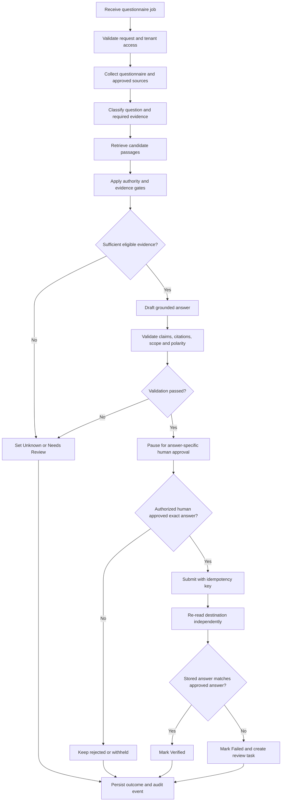

Security Questionnaire Filler
Ziro Agentic AI Hackathon 2026 — Powered by Ziro.Digital
Industry: Developer & Enterprise AI
Problem statement: Security Questionnaire Filler
Current demo: Browser-based application with a synthetic mock questionnaire portal

A vendor security questionnaire assistant that answers only from approved policy documents and a certification registry. Every supported answer is tied to evidence; unsupported or ambiguous questions become Unknown or Needs Review rather than receiving invented claims.

Human approval is mandatory before every portal write. After submission, a separate verification step re-reads the destination and checks what was actually stored.
Important scope note: The current working demo is a zero-dependency HTML/CSS/JavaScript application. LangGraph, a production backend, PostgreSQL, Redis, Celery, and a production deployment are described below as a proposed evolution—not as already implemented features.

Contents
1. Quick start
2. What the application includes
3. Workflow and current implementation
4. Evidence and safety gates
5. Verification and test results
6. Official test scenarios
7. Decision rules
8. Current project structure
9. Target LangGraph architecture
10. Graph state and node responsibilities
11. Production infrastructure responsibilities
12. Human approval, retries, and verification
13. Proposed production API
14. Security and multi-tenancy
15. Production implementation roadmap
16. Running and deploying the current demo
17. Current limitations
1. Quick start
The current demo uses plain HTML, CSS, and JavaScript with zero dependencies, no build step, and no required network connection.
Option A — Open directly
Open index.html in a modern browser.
Option B — Use the included PowerShell server
powershell -ExecutionPolicy Bypass -File serve.ps1 -Port 8777
Then visit:
http://localhost:8777/
The optional OpenAI-compatible LLM adapter is disabled by default. The deterministic workflow can be demonstrated offline.
Keyboard shortcuts
- r — run the agent
- v — verify results against the portal
- t — run the four test scenarios
- 1–9 — navigate among the first nine tabs
All example data is synthetic. Do not treat the current mock environment as a production customer system.
2. What the application includes
The current interface contains 11 tabs.
Tab	Purpose
Dashboard	KPIs for total questions, answered, unknown, needs review, approved, filled, verified, and failed; progress indicators; review queue; evidence coverage; test status; recent activity; compliance checklist
Questionnaire	Question-level answers, statuses, citations, policies, approval and verification states; text search and category, policy, and status filters
Policies	Policy IDs, versions, types, statuses, authority, effective dates, owners, usage counts, sections, and extracted facts
Evidence	Cited passages, source versions, retrieval timestamps, quotes, scores, rejected candidates, and reasons a source was excluded
Review queue	Review evidence, edit a proposed answer, approve an individual answer, reject it, or inspect traceability; bulk approval does not override an explicit rejection
Mock portal	Synthetic questionnaire portal and current stored answers, clearly labelled as mock data
Agent run	Six-step pipeline timeline, run summary, decision log, proposal status, safety gates, and destination
Results	Answered / Unknown / Needs Review buckets and per-question verification details, including V0–V8 check results
Test cases	TC1–TC4 input, expected and actual results, evidence, individual checks, differences, and timestamps
Audit log	Event ID, timestamp, actor, action, question, previous and new state, evidence reference, and verification summary
Settings	Deterministic or optional OpenAI-compatible mode, thresholds, transport, simulated latency, state export/import, demo reset, and mock API self-test

Visible demo safeguards
- A persistent DEMO / SYNTHETIC DATA banner identifies the fictional scenario.
- Long-running actions display status messages.
- Empty states explain why no results are present.
- The audit and evidence views expose decisions instead of hiding unsupported outcomes.
- The documented UI test pass covered 11 tabs and 47 interactive elements.
3. Workflow and current implementation
The current application uses a deterministic six-step pipeline. The following table describes the implementation in this repository—not the future LangGraph backend.
Workflow step	Current implementation	Output
1. Collect	collect() in src/core/agent.js reads the questionnaire, source index, source documents, certification registry, and portal state through src/core/transport.js. Schema checks run first.	Recorded portal requests with URL, status, timestamp, byte count, ETag, and content hash
2. Plan	plan() assigns RULE-SUPPORTED-FACTS, required evidence, routing, and a strategy such as policy-lookup or registry-lookup.	A per-question plan
3. Retrieve	src/core/retrieval.js chunks sources, scores passages, and applies the authority gate.	Eligible passages and rejected candidates with reasons
4. Propose and submit	The agent creates an answer proposal, action ID, destination, and idempotency key. Writes are restricted to individually approved answers.	Proposed, approved, rejected, submitted, or deduplicated action states
5. Verify	src/core/verifier.js re-reads the portal, re-fetches cited documents, and runs V0–V8 checks.	Verified, failed, or pending status
6. Present results	The Results tab and traceability details show the outcome for each question.	Answered, Unknown, and Needs Review states

The current retrieval score combines:
- IDF-weighted text overlap: 0.45
- Category match: 0.15
- Aspect-tag match: 0.40
The score is only one input into the decision. It does not override document authority, scope, conflicts, claim validation, or human approval.
4. Evidence and safety gates
The demo implements five central safety gates.
4.1 Source authority
Draft, superseded, archived, and non-authoritative documents cannot support an answer. Rejected candidates remain visible with machine-readable reasons. For example, a superseded POL-ENC-2023 v2.0 may be retrieved for comparison but is not eligible to ground a current answer when it has been superseded by the authoritative policy.
4.2 Evidence sufficiency
If no eligible passage meets the evidence threshold, the result is Unknown and a reviewer task is created. The search trail remains available so a reviewer can see which sources were considered.
4.3 Claim guard
Claims involving numbers, algorithms, dates, encryption methods, or certifications must be grounded in the cited evidence. Certification claims must also be consistent with the certification registry. Unsupported claims are rejected or fail verification.

Examples covered by the demo:
- An unsupported claim that the company holds PCI DSS certification is rejected.
- An honest statement that PCI DSS certification is not held can be accepted when supported by the registry.
- An unsupported AES-512 claim is rejected as an ungrounded number.
4.4 Human approval
No portal write occurs until a named human approves that specific answer. Answers without citations cannot be approved for submission. A reviewer can edit a proposal, but the edited answer is still checked against its evidence.
4.5 Idempotency and independent verification
Writes carry a content-derived idempotency key. Repeating the same submission must not create a duplicate response. After a write, the verifier independently re-reads the destination and compares the stored answer with the intended answer.

The current demo uses a key pattern similar to:
sqf-QNR-2026-0417-Q-01-<hash>
The exact key is derived from the relevant action content and identifiers.
5. Verification and test results
The following results are the documented results of the current demo build, run through the UI on a clean seed and repeated after a page reload. They are not a claim that a production backend or external customer portal has been tested.
5.1 End-to-end demo flow
Step	Action	Observed result
1	Reset demo	Run cleared, portal has zero writes, approvals and test runs cleared
2	Run agent	15 questions: 11 answered, 3 unknown, 1 needs review; zero portal writes
3	Approve all cited answers	11 individual approval decisions recorded
4	Submit approved answers	11 submitted, 0 deduplicated, 4 skipped/withheld
5	Verify portal	11 verified, 0 failed, 4 pending
6	Run all scenarios	TC1–TC4 all pass
7	Check dashboard	17 of 17 computable checklist rows satisfied; 1 row not applicable

The documented browser run reported zero console errors and zero warnings.
5.2 Adversarial and edge-case checks
- Rejected answer remains excluded: Rejecting Q-06 and bulk-approving the other cited items results in 10 approvals and 1 rejection. The rejected answer is not written to the portal.
- Duplicate action protection: Submitting again after the 11 approved answers are already stored returns 0 new submissions and 11 deduplicated actions. The portal state remains unchanged.
- Edited answer is revalidated: Reviewer edits are audited with old and new text. An edit that adds an unsupported number or certification must fail validation rather than silently pass.
- Unsupported claims are rejected: The PCI DSS and AES-512 claim-guard examples behave as described in Section 4.
- Superseded source is excluded: The evidence view records the superseded source and the reason it was not used.
- Mock portal API self-test: 13/13 documented checks passed, including successful reads, unknown-route and unknown-resource errors, missing idempotency-key rejection, valid write, and duplicate-write handling.
- Persistence: After browser reload, the run, approvals, portal responses, and verification result remain available through browser localStorage.
- Evidence export: The documented export is approximately 397 KB of JSON, containing the run, citations, audit trail, tests, and compliance checklist. The test reported no API key or key-like string in the export.
- LLM outage: With an unreachable OpenAI-compatible endpoint, the documented run recorded failed calls and fell back to the deterministic engine, retaining the same 11/3/1 result.
6. Official test scenarios
The four scenarios are executed from the Test Cases tab. Each scenario runs against a freshly seeded synthetic environment.
Case	Scenario	Expected behavior	Documented result
TC1	Encryption question with policy evidence	Answer must cite an eligible policy passage	PASS — Q-01 answered using POL-ENC-001 v3.1, sections 3.2 and 3.3; the documented verification checks passed
TC2	No evidence for a control	Mark the question Unknown rather than invent an answer	PASS — Q-04 marked Unknown; best score 0.053 was below the 0.22 threshold
TC3	Superseded 2023 policy	Do not use the superseded source	PASS — Q-14 answered from POL-ENC-001 v3.1; no citation from the superseded policy
TC4	Certification the company lacks	Never assert an unheld certification	PASS — Q-11 gives a negative PCI DSS certification statement grounded in the synthetic certification registry

Documented run summary
Answered: 11
Unknown: 3
Needs review: 1
Answer coverage: 73.3%

Portal writes: 11 created
Duplicate writes: 0
Withheld: 4

Verification: 11 verified
Failed: 0
Pending: 4

Rejected sources include:
- POL-ENC-2023
- SRC-MKT-FAQ
- SRC-PRIOR-QNR-2023

Unknown:
- Q-04 removable media
- Q-05 background screening
- Q-13 AI model training

Needs review:
- Q-15 encryption across non-production environments
The reported answer text and results are based on the synthetic policies and registry bundled with the demo. They are not evidence about any real vendor.
7. Decision rules
Rule	Trigger	Outcome
RULE-SUPPORTED-FACTS	No eligible passage meets the evidence threshold	Unknown, reviewer task, and search trail
RULE-SCOPE-COVERAGE	The question asks about a scope the evidence excludes	Needs Review
RULE-CONFLICT	Eligible evidence conflicts	Needs Review
RULE-CONFIDENCE	Evidence falls in the configured low-confidence band	Needs Review
RULE-POLARITY-AFFIRMATIVE / RULE-POLARITY-NEGATIVE	The supported clause is affirmative or restrictive	Answer with the supported polarity
RULE-POLARITY-CONFLICT	Relevant clauses disagree about the requested version or scope	Needs Review
Authority gate	Source is not active or not authoritative	Reject candidate and record reason
Claim guard	Number or certification claim is unsupported	Reject or fail verification

Unknown means sufficient approved evidence was not found to answer the question. Needs Review means the available evidence is ambiguous, conflicting, or insufficient for the requested scope. These states are intentionally different.
8. Current project structure
index.html                  Single-page UI shell and 11 tabs
serve.ps1                   Optional zero-dependency local HTTP server
assets/styles.css           UI styling
src/
  data/
    dataset.js              Synthetic policies, registry, questionnaire, and decoys
  core/
    util.js                 Hashing, normalization, tokenizing, export helpers
    store.js                State, local persistence, audit events, approvals
    transport.js            Portal I/O boundary: mock and HTTP transport
    retrieval.js            Chunking, IDF scoring, authority gate, clause selection
    llm.js                  Optional LLM adapter with validated outputs and guardrails
    agent.js                Six-step workflow, decisions, proposals, approvals, writes
    verifier.js              Independent verification V0–V8 and claim guard
    scenarios.js             TC1–TC4 sandboxed scenario runner
  ui/
    ui.js                    Rendering, filters, dashboard, self-test, event handling
docs/
  ARCHITECTURE.md            Current component design and trade-offs
  PRESENTATION.md            Eight-slide presentation outline and speaker notes
  EVIDENCE.md                Rubric mapping and reproduction steps
9. Target LangGraph architecture
This section describes a proposed backend architecture for evolving the current demo. It is not a statement that LangGraph or the listed backend services are already wired into the deployed application.
Why LangGraph?
The current deterministic pipeline is useful for demonstrating evidence-grounded answers, abstention, human approval, and post-write verification. LangGraph is a candidate orchestration layer when the workflow needs explicit graph state, conditional routing, resumable execution, checkpoints, and human-in-the-loop pauses.

The model should help interpret questions and draft evidence-grounded answers. It must not be the authority for access control, source eligibility, certification status, approval, or whether a portal write is permitted.
Proposed workflow diagram

Logical agent roles
These are logical responsibilities in a graph. They do not need to be separate autonomous LLM agents.
1. Workflow orchestrator — controls graph state, routing, retries, and pause/resume behavior.
2. Question classifier — identifies control category, scope, polarity, and evidence type; output is schema-validated.
3. Evidence researcher — retrieves policy passages and registry records, preserving source metadata and rejected candidates.
4. Answer drafter — drafts concise responses using eligible evidence only.
5. Compliance validator — deterministically checks source authority, claim grounding, scope, dates, numbers, algorithms, certifications, and citations.
6. Approval and submission controller — enforces human approval, idempotency, permission checks, and submission rules.
7. Independent verifier — re-reads the destination and compares its actual state with the approved payload.
Keep high-risk decisions deterministic and testable. Do not allow an LLM to approve its own answer or bypass the graph's approval and validation gates.
10. Graph state and node responsibilities
Proposed node responsibilities
Node	Responsibility	Mandatory control
validate_request	Validate input, identity, tenant, permissions, and questionnaire ID	Reject unauthorized or malformed requests before retrieval
collect_context	Load questions, approved policy versions, certification registry, and destination state	Record source version, timestamp, and content hash
classify_question	Identify control category, scope, polarity, and evidence type	Validate model output against a strict schema
retrieve_evidence	Retrieve and rank candidate passages	Preserve source ID, version, section, quote, timestamp, and score
apply_authority_gate	Exclude drafts, superseded, archived, and non-authoritative sources	Similarity scores cannot override authority
assess_evidence	Determine sufficiency, conflicts, scope coverage, or absence	Route unsupported items to Unknown or Needs Review
draft_answer	Generate a concise evidence-grounded response	Material claims must map to eligible evidence
validate_answer	Check citations, claims, scope, polarity, and prohibited unsupported assertions	Fail closed on validation errors
request_human_approval	Pause and show the exact answer, evidence, and destination	Approval is user-attributed and answer-specific
submit_answer	Write only an approved answer	Recheck permission and use an idempotency key
verify_submission	Re-read destination and compare actual content	Do not trust the submit response alone
persist_result	Store outcomes and append audit events	Record decisions, failures, retries, and verification

Proposed typed graph state
Use a versioned typed state (for example, a Python TypedDict or validated Pydantic model) that carries structured data and references—not secrets.
- Request context: tenant ID, user ID, questionnaire ID, run ID, correlation ID.
- Question context: question ID, original text, category, requested scope, evidence type.
- Evidence: source ID, version, section, exact quote, authority status, retrieval timestamp, content hash, score.
- Decision: status (answered, unknown, needs_review), answer text, reason codes, confidence signals, validation results.
- Approval: reviewer ID, decision, timestamp, approved answer hash, approval state.
- Action: destination, idempotency key, attempt count, response metadata, reconciliation status.
- Verification: observed destination value, comparison result, checks passed/failed, follow-up task.
- Audit references: event IDs and trace/correlation IDs.
Never place API keys, access tokens, or other secrets in graph state, checkpoints, prompts, ordinary logs, or evidence exports.
Conditional routing
- No eligible evidence → Unknown or Needs Review.
- Conflicting evidence or scope mismatch → Needs Review.
- Failed claim validation → do not submit; record a validation failure and route to review.
- Valid answer → pause for a named human's decision.
- Rejected or unapproved answer → remain withheld.
- Approved answer → submit with idempotency protection.
- Failed verification → record failure and open a reconciliation/review task.
11. Production infrastructure responsibilities
These components solve different problems and are not interchangeable.
Component	Proposed responsibility
LangGraph	Workflow graph, state transitions, conditional routing, human-interrupt points, resumable execution
LangChain	Optional model/provider integrations, prompt templates, output parsers, and retrieval integrations
FastAPI	Authenticated backend API, request validation, permissions, rate limiting, and frontend integration
PostgreSQL	Durable business records: tenants, users, questionnaires, sources, approvals, actions, results, and audit events
LangGraph checkpointer	Save graph execution state so an interrupted run can resume
Redis (optional)	Short-lived cache, queue broker, rate-limit coordination, or transient coordination
Celery (optional)	Background tasks, scheduled synchronization, and bounded retry jobs
Object storage (optional)	Policy uploads, large evidence bundles, and exports with access control and retention rules
Observability stack	Structured logs, metrics, traces, latency, error rates, retry counts, and alerts

PostgreSQL versus graph checkpointing
PostgreSQL business tables are the durable record of application entities and decisions. A LangGraph checkpointer stores graph execution state needed to resume a run. These are related but different concerns; one should not be treated as a substitute for the other.
Redis and Celery
Redis can act as a broker or transient coordination layer. Celery workers can execute long-running tasks outside the request/response path. Neither provides exactly-once portal writes by itself. Safe retries still require idempotency keys, bounded retry policies, and reconciliation with the destination.

Do not add Redis and Celery just because the architecture uses agents. Introduce them when background execution, workload volume, scheduling, or operational requirements justify the added complexity.
12. Human approval, retries, and verification
Approval must be bound to the exact answer
When the graph reaches the approval step, it should pause with the exact proposed text, citations, evidence versions, destination, and answer hash. The approval endpoint must check:
1. The reviewer is authenticated and authorized for the tenant.
2. The reviewer is permitted to approve that questionnaire or control.
3. The answer hash matches the answer shown to the reviewer.
4. The evidence versions and destination have not changed in a way that invalidates the decision.
5. The approval is recorded with reviewer identity and timestamp.
If the answer, source version, destination, or relevant scope changes, invalidate the previous approval and request a new one. A page visit or questionnaire-level approval is not approval for every answer.
Safe submission and retry design
- Use a stable idempotency key for each logical answer submission.
- Persist the intended action before attempting the external write.
- Retry only transient failures and only within a bounded policy.
- Use exponential backoff with jitter where appropriate and respect documented portal rate limits.
- Do not blindly retry non-idempotent writes.
- If a request times out after the destination may have accepted it, read the destination and reconcile before retrying.
- Record attempt number, status, timestamps, response metadata, and final outcome.
- Treat permanent authorization or validation failures differently from transient network failures.
Independent verification
The verifier should retrieve the stored destination answer and compare it with the exact approved payload. It should verify destination identity, question identity, answer content, and relevant metadata. A successful HTTP response from a write endpoint is not sufficient evidence that the intended answer was stored correctly.
13. Proposed production API
These endpoints are a suggested future backend contract. They are not served by the current static demo.
Method	Endpoint	Purpose
POST	/api/v1/runs	Start a questionnaire-processing run
GET	/api/v1/runs/{run_id}	Read run status and progress
GET	/api/v1/runs/{run_id}/questions	Read question decisions, answers, and citations
GET	/api/v1/reviews	List authorized pending review items
POST	/api/v1/reviews/{review_id}/decision	Approve, reject, or request an edit for one answer
POST	/api/v1/actions/{action_id}/submit	Submit a previously approved answer
POST	/api/v1/runs/{run_id}/verify	Start or request independent verification
GET	/api/v1/runs/{run_id}/audit	Read authorized audit events
POST	/api/v1/sources	Register or upload a source for validation and ingestion
GET	/api/v1/health	Return liveness/readiness information without secrets

A production API should include request schemas, authentication, tenant-scoped authorization, pagination, structured errors, request IDs, rate limits, and audit events. Validate destination hosts and network access to reduce server-side request forgery (SSRF) risk. Do not allow a model to supply arbitrary destination URLs or credentials.
14. Security and multi-tenancy
The current demo is synthetic and browser-based. Before handling real customer data, a backend implementation should add at least the following controls.
Identity and access
- Authenticate users and use role-based permissions.
- Enforce tenant scope server-side for every read and write.
- Keep reviewer, operator, administrator, and read-only permissions distinct.
- Recheck permissions immediately before a consequential action.
- Do not trust tenant IDs supplied by the browser without verifying access.
Secrets and data protection
- Store provider credentials in a server-side secret manager or protected environment configuration.
- Never send API keys to the browser or include them in graph state, audit logs, prompts, or exports.
- Encrypt traffic in transit and apply appropriate encryption at rest.
- Define retention, deletion, and export policies for questionnaires, source documents, and evidence.
- Redact secrets and unnecessary personal information from logs.
Retrieval and model safety
- Treat uploaded documents and retrieved text as untrusted data, not as instructions to the agent.
- Separate policy content from system instructions.
- Validate all structured model outputs.
- Apply deterministic source-authority and claim-validation rules after model generation.
- Restrict model and worker access to only the data required for the task.
- Do not permit prompt-injected content to grant permissions, approve an answer, or change a destination.
Portal and operational safety
- Use allowlisted destination hosts and validated routes.
- Use documented APIs and respect portal permissions and rate limits.
- Do not bypass CAPTCHA, OTP, access controls, or other human-only checks.
- Apply timeouts, bounded retries, idempotency, and destination reconciliation.
- Maintain an append-only audit trail for consequential decisions.
- Test cross-tenant access, stale approvals, duplicate requests, model outages, and partial failures.
15. Production implementation roadmap
The following is a proposed sequence for moving from the current hackathon demo to a backend architecture.
Phase 1 — Establish the backend boundary
- Create a backend service and versioned API.
- Move business state out of browser-only storage.
- Define schemas for questionnaires, policies, evidence, decisions, approvals, actions, verification, and audit events.
- Keep the existing deterministic pipeline as a behavioral reference during migration.
Phase 2 — Implement persistence and identity
- Add PostgreSQL migrations and tenant-scoped repositories.
- Implement authentication, authorization, and reviewer identity.
- Persist approvals and audit events independently of the browser session.
- Store source versions and content hashes so decisions can be reproduced.
Phase 3 — Implement the LangGraph workflow
- Define a typed, versioned graph state.
- Implement explicit nodes and conditional edges.
- Configure a persistent checkpointer.
- Add an interrupt/resume flow for human approval.
- Test resume after process restart and invalidation of stale approvals.
Phase 4 — Add evidence ingestion and retrieval
- Validate and version policy documents.
- Extract text and metadata in a controlled ingestion pipeline.
- Preserve exact citations and source versions.
- Evaluate retrieval quality on a curated question/evidence test set.
- Consider embeddings or hybrid retrieval only when evaluation shows a benefit over the existing deterministic baseline.
Phase 5 — Add reliable background execution
- Add a worker queue if processing duration, scheduling, or throughput requires it.
- Use Redis/Celery only with explicit retry, idempotency, and monitoring policies.
- Add timeout handling, rate limits, dead-letter or failed-task handling, and destination reconciliation.
Phase 6 — Harden and evaluate
- Add unit, integration, security, and end-to-end tests.
- Test unsupported claims, conflicting sources, superseded policies, missing evidence, stale approval, duplicate writes, timeouts, and model/provider outages.
- Add structured logging, metrics, traces, and alerts.
- Perform a security and privacy review before connecting production data or external portals.
Acceptance criteria
A production-ready implementation should demonstrate that:
- An unsupported claim cannot pass validation or reach a destination.
- A draft or superseded source cannot ground an answer.
- An answer without an eligible citation cannot be approved for submission.
- A reviewer decision is tied to the exact answer and source versions.
- An unapproved answer cannot be written, including after a retry or restart.
- Duplicate submission requests do not create duplicate destination records.
- A timeout after a possible write triggers reconciliation rather than a blind repeat.
- Verification re-reads the destination and reports mismatches.
- Tenant boundaries are enforced on every endpoint and background task.
- Graph runs can pause and resume after approval without losing auditability.
16. Running and deploying the current demo
The current application is static and can be hosted without a server-side component.
- Local: Open index.html or run the included serve.ps1 script.
- Static hosting: The current frontend can be hosted on GitHub Pages, Netlify, Cloudflare Pages, S3, or an internal static web server.
- Offline: The deterministic demo can run without a network connection.
The existing src/core/transport.js contains the portal I/O boundary and supports mock and HTTP transport paths. Switching to an HTTP transport does not by itself make the application production-ready: authentication, server-side secrets, tenant isolation, endpoint security, persistence, and external portal behavior must be implemented and tested separately.
17. Current limitations
- Mock portal: The demo uses a synthetic portal (mock-portal.ziro.local) implemented within the application. It does not demonstrate a completed integration with a real customer portal.
- Synthetic data: The vendor, customer, policies, questionnaire, and certification registry are fictional.
- Small policy corpus: The policy collection is hand-built. Production use would require document ingestion, versioning, access controls, and retrieval evaluation.
- Deterministic retrieval: Current retrieval uses keyword/IDF-style scoring and metadata signals. Embeddings and hybrid retrieval are future options, not a current implementation claim.
- Optional LLM adapter: It uses an OpenAI-compatible chat-completions contract and has been tested for graceful fallback. The documented run does not establish reliability against every live provider.
- Browser persistence: The current state is stored in browser localStorage. That is appropriate for the zero-install demo, not for multi-user production storage.
- No production backend claim: LangGraph, FastAPI, PostgreSQL, Redis, Celery, multi-tenant backend services, and the proposed production API remain target architecture until implemented and verified.
- Human review remains essential: Unknown and Needs Review outcomes are intentional safety behavior. The system should not turn missing or conflicting evidence into a confident assertion.
The core design principle is simple: evidence before answers, explicit abstention when evidence is insufficient, human approval before consequential writes, and independent verification afterward.
