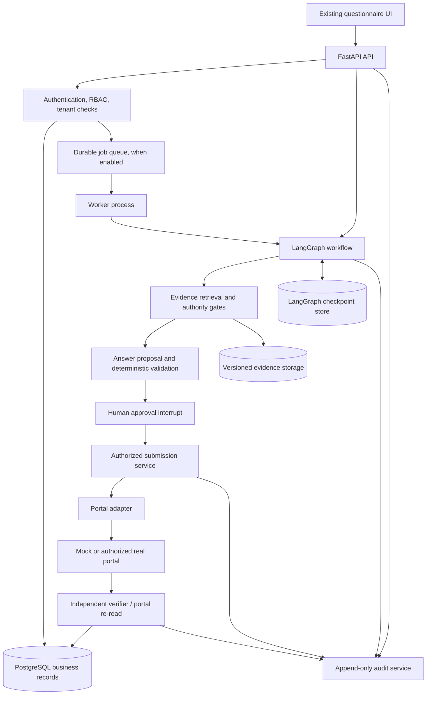
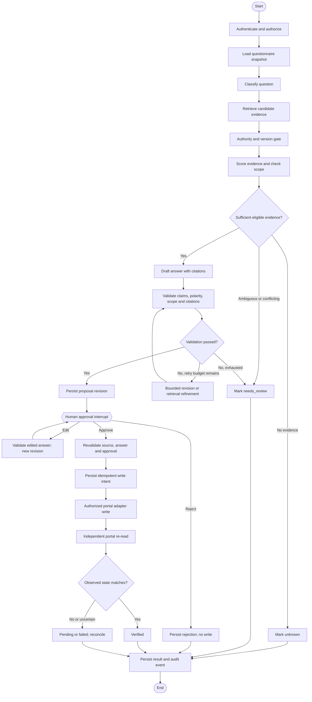

# LangGraph Architecture — Security Questionnaire Filler

> Architecture proposal for evolving the existing Security Questionnaire Filler into a stateful, evidence-grounded, human-approved workflow. This document describes the target design; it does not claim that every component is already implemented.

## 1. Goals and non-negotiable principles

The system must answer security questionnaires using approved evidence rather than plausible-sounding guesses. It should retain the current predefined-answer baseline while introducing progressively more dynamic retrieval and LangGraph orchestration.

Core principles:

1. **Evidence before answers:** an answer must be supported by eligible, versioned source material.
2. **Abstention is valid:** missing, stale, ambiguous, or conflicting evidence results in `unknown` or `needs_review`.
3. **LLMs propose; deterministic controls decide:** model output never overrides source authority, permissions, claim validation, or approval requirements.
4. **Human approval before external writes:** no portal write is permitted without approval for the exact answer revision.
5. **Independent verification:** after a write, read the portal again and compare observed state with the approved record.
6. **Durable state:** graph checkpoints support workflow recovery; PostgreSQL remains the source of truth for business records.
7. **Idempotent side effects:** retries must not create duplicate answers or silently repeat unsafe writes.
8. **Tenant isolation:** all business data and operations are scoped to the authenticated tenant and authorized user.

## 2. Proposed technology stack

- **Frontend:** existing UI initially; React + TypeScript can be adopted incrementally if a frontend migration is justified.
- **API:** Python, FastAPI, Pydantic.
- **Orchestration:** LangGraph for graph state, conditional routing, checkpoints, and human interrupts.
- **Model integration:** LangChain model interfaces with schema-constrained output; provider can be configured (hosted model or local Ollama where suitable).
- **Primary database:** PostgreSQL.
- **Graph checkpointing:** LangGraph PostgreSQL checkpointer in production; in-memory checkpointer for isolated tests only.
- **ORM and migrations:** SQLAlchemy and Alembic.
- **Background jobs:** initially FastAPI background execution only for lightweight development tasks; add Celery + Redis or another durable queue when asynchronous processing, worker pools, and retries are needed. Queue messages are not the business record.
- **Evidence files:** S3-compatible object storage or equivalent private storage.
- **Testing:** pytest, HTTPX, graph tests, integration tests, security tests, scenario regression tests.
- **Observability:** structured logs, metrics, OpenTelemetry; optional LangSmith tracing with sensitive-data controls.
- **Deployment:** Docker; managed PostgreSQL and container workers for production.

## 3. High-level architecture



**Separation of responsibilities:** LangGraph controls workflow progression. PostgreSQL stores business truth. The checkpointer stores resumable graph state. Deterministic services enforce authorization, evidence eligibility, claim checks, idempotency, and verification. The portal adapter is the only component allowed to perform external portal I/O.

## 4. Six logical agents and deterministic services

These are logical roles, not six required model deployments. Several roles can use the same LLM; critical controls should remain deterministic.

1. **Orchestrator:** coordinates nodes and routes based on typed state and explicit outcomes. Prefer deterministic routing over an LLM choosing arbitrary tools.
2. **Question Classification Agent:** classifies question intent, category, scope, and materiality into an allowlisted schema. Invalid categories are rejected.
3. **Evidence Research Agent:** retrieves candidate source sections, expands query terms, ranks evidence, and records rejected candidates. It cannot mark a source authoritative by itself.
4. **Answer Generation Agent:** drafts a response only from supplied eligible evidence and produces citations and supporting quotations.
5. **Compliance Validation Agent:** checks claim grounding, source authority, scope coverage, polarity, numeric claims, certification registry entries, and citation integrity. Deterministic validators are the final gate.
6. **Verification Agent:** evaluates the actual remote portal state independently of the proposal-generation path.

**Not agents:** authentication, RBAC, approval persistence, database writes, queue management, idempotency, portal transport, and audit logging are deterministic application services. Human approval is a workflow interrupt, not an AI agent.

## 5. LangGraph workflow



### Routing policy

- Reject sources that are drafts, superseded, expired, or informational when authoritative evidence is required.
- Preserve current scoring configuration if migrating the existing implementation. If the current thresholds are 0.22 and 0.375, keep them configurable and record the threshold version used for each run.
- A score above threshold is necessary but not sufficient: scope, polarity, specificity, and source authority must also pass.
- Bound retrieval refinement and answer-revision attempts. Exhaustion routes to `needs_review`, not endless loops.
- Unknown, needs-review, and rejected items cannot be submitted.
- A changed answer or changed supporting source invalidates the prior approval.
- A timeout after a remote write is an unknown outcome until reconciliation proves whether the write occurred.

## 6. State schema

Use a typed state schema (TypedDict or Pydantic-backed state) containing references and compact workflow data. Do not place secrets in graph state.

Suggested state fields:

```python
class QuestionnaireState(TypedDict, total=False):
    run_id: str
    tenant_id: str                 # server-derived; never LLM-controlled
    questionnaire_id: str
    questionnaire_version: str
    thread_id: str
    question_ids: list[str]
    current_question_id: str
    question_classifications: dict[str, dict]
    evidence_candidates: dict[str, list[dict]]
    evidence_decisions: dict[str, dict]
    proposal_revisions: dict[str, list[dict]]
    approval_references: dict[str, str]
    write_intent_references: dict[str, str]
    verification_references: dict[str, str]
    run_status: str
    retry_counts: dict[str, int]
    error_references: list[str]
```

Persist full evidence, proposals, approvals, write attempts, and verification checks in PostgreSQL. The graph state should reference durable record IDs and include only what is needed to resume safely. Use stable thread IDs scoped to the tenant and run.

## 7. Evidence retrieval and answer grounding

### Evidence record

Each source should include:

- `source_id`, title, source type, owner and tenant;
- immutable `version`, status, authority, effective date and supersession relationships;
- source URI or private storage reference;
- section identifiers, normalized text, structured facts, categories and aspect tags;
- content hash and ingestion timestamp.

### Retrieval path

1. Normalize the question and classify its category and scope.
2. Expand with controlled synonyms/aspect tags.
3. Retrieve candidate sections using transparent lexical scoring initially; add embeddings/pgvector only if evaluation shows meaningful improvement.
4. Apply authority and version gates before an answer can cite a source.
5. Score evidence and record the breakdown, candidate set, rejected sources, conflicts and thresholds.
6. Verify scope coverage and polarity of the exact supporting clause.
7. Generate the answer from eligible evidence only.
8. Confirm each quotation is a verbatim substring of the cited source and every material claim is supported.

The model may reorder only supplied candidate IDs; it must not invent evidence IDs, URLs, facts, certification status, or quotations. On model timeout or schema failure, use a safe deterministic fallback or route to review.

## 8. Human approval and revision rules

Approval is a durable state transition with a persisted record. Store:

- reviewer user ID and tenant membership;
- decision (`approved`, `rejected`, `changes_requested`);
- proposal revision ID and exact approved text hash;
- cited source IDs, versions and hashes;
- timestamp and optional reviewer note;
- authorization context and audit event ID.

On resume, reload the approval record from PostgreSQL and revalidate it. Never trust an `approved=true` flag supplied by the client or LLM. Bulk approval must not override an explicit rejection. Editing an approved answer creates a new revision and requires approval again.

## 9. Submission, idempotency and verification

### Submission protocol

1. Check authenticated actor, tenant, permission, current approval, proposal revision and evidence freshness.
2. Create a durable write-intent record transactionally before external I/O.
3. Derive a stable idempotency key from tenant, questionnaire, question, approved revision/content hash and destination. Persist it with a unique constraint.
4. Dispatch the portal operation through a capability-aware adapter.
5. Record attempt metadata, response status and remote identifiers without logging secrets.
6. Independently re-read the portal state and compare exact approved content and citation metadata where supported.
7. Mark the outcome `verified`, `failed`, or `pending`; never infer success from a successful HTTP response alone.

### Safe retry rules

- Use bounded exponential backoff with jitter for transient failures and respect provider `Retry-After` guidance.
- Do not blindly retry a non-idempotent write after timeout. Reconcile the remote state first.
- Treat task delivery as potentially at-least-once. Idempotency must be enforced in application/database logic and, where supported, at the portal.
- If the remote system cannot be queried reliably, stop and route to manual reconciliation.

## 10. Portal adapter contract

Each adapter should declare:

- supported operations (`read_questionnaire`, `read_answer`, `write_answer`, `verify_answer`);
- authentication method and required scopes;
- rate limits and concurrency budget;
- idempotency support and remote request identifiers;
- read-after-write verification capability;
- retryable error classifications;
- terms/permission requirements and integration status.

Use a mock adapter in development and tests. Real integrations must use authorized access and comply with the target portal's documented rules. The LLM must not get unrestricted browser, HTTP, or database-write access.

## 11. Data model

Recommended PostgreSQL tables:

- `tenants`, `users`, `memberships`, `roles`
- `questionnaires`, `questionnaire_versions`, `questions`
- `source_documents`, `source_versions`, `source_sections`, `evidence_chunks`
- `agent_runs`, `run_items`, `evidence_candidates`
- `proposals`, `proposal_citations`, `approval_records`
- `write_intents`, `submission_attempts`
- `verification_runs`, `verification_checks`
- `audit_events`, `outbox_events`
- LangGraph-managed checkpoint tables

Use foreign keys, tenant-scoped repository queries, unique idempotency constraints, immutable proposal revisions, and append-only audit privileges. Consider PostgreSQL row-level security as an additional isolation layer, not as a replacement for application authorization.

## 12. API surface

Example API routes (adjust to current frontend contracts):

- `POST /api/questionnaires` — create/import questionnaire
- `GET /api/questionnaires/{id}` — retrieve questionnaire
- `POST /api/questionnaires/{id}/runs` — create an asynchronous run and return `run_id`
- `GET /api/runs/{run_id}` — run status and summary
- `GET /api/runs/{run_id}/items` — per-question state and evidence
- `GET /api/items/{item_id}/evidence` — inspect citations and rejected candidates
- `POST /api/proposals/{proposal_id}/decision` — approve, reject, or request changes
- `POST /api/proposals/{proposal_id}/edit` — create a new proposal revision
- `POST /api/submissions/{write_intent_id}/reconcile` — request safe remote reconciliation
- `GET /api/runs/{run_id}/verification` — verification results
- `GET /api/audit` — tenant-authorized audit search/export

All endpoints require authentication, schema validation, tenant checks, permission checks, rate limits, and safe error handling. Never expose raw secrets or unrestricted checkpoint internals through the API.

## 13. Background processing: when to add Celery + Redis

Celery and Redis are optional infrastructure, not requirements for LangGraph itself.

Add them when questionnaire runs are too long for request/response handling, jobs need worker pools, or retries and concurrency controls are required. FastAPI creates a durable run record and dispatches a task; a Celery worker starts or resumes LangGraph using the persisted run/thread ID. The graph checkpoint stores workflow progress; PostgreSQL stores business records; Redis carries task messages.

Production considerations:

- use durable job records and a transactional outbox or equivalent dispatch strategy;
- configure worker acknowledgement/recovery deliberately;
- assume tasks may execute more than once;
- cap concurrent model and portal requests;
- separate CPU/model work from external submission workers if workloads differ;
- avoid keeping a Celery task occupied while waiting for a human approval; persist the interrupt and resume on a later task;
- monitor queue age, retry count, task duration, dead-letter volume and failure rate.

## 14. Security requirements

- Derive tenant identity and permissions from authenticated server context.
- Enforce RBAC in API and service layers; UI hiding is not authorization.
- Encrypt provider tokens and credentials in a secrets manager or protected secret store; never put them in graph state, prompts, logs, or exported evidence.
- Treat retrieved documents and portal text as untrusted data to defend against prompt injection.
- Restrict network egress for portal adapters and allowlist destinations where possible.
- Validate all LLM outputs with typed schemas and deterministic checks.
- Redact PII and secrets from traces; configure retention and access controls for observability systems.
- Audit source changes, decisions, edits, submission attempts, reconciliation, exports and administrative access.
- Use least-privilege database roles and append-only audit permissions.

## 15. Testing and acceptance criteria

### Unit tests

- scoring and threshold boundaries;
- source authority, freshness and supersession;
- quote-verbatim and citation integrity;
- scope, polarity, specificity and certification checks;
- idempotency-key stability and tenant scoping.

### Graph tests

- every conditional route;
- no-evidence and conflicting-evidence paths;
- bounded revision loops;
- approval interrupt and resume after process restart;
- changed source or answer invalidates approval;
- errors route to pending/failed rather than false success.

### Integration and security tests

- mock portal 200/201/400/404/duplicate/error cases;
- timeout after remote write followed by reconciliation;
- worker crash and duplicate task delivery;
- cross-tenant access denial;
- forged approval and unauthorized write denial;
- prompt injection in evidence documents;
- secret redaction and export hygiene.

### Verification invariants

- V0: no unapproved write exists;
- V1: approved answer exists remotely;
- V2: stored text equals the approved revision;
- V3: citation metadata is stored where the portal supports it;
- V4: reviewer identity is recorded;
- V5: cited sources remain eligible at verification time;
- V6: cited quotations remain verbatim;
- V7: claims and certification statements pass grounding checks;
- V8: at most one created write exists per idempotency key.

A verification failure must never be reported as success. Keep unresolved outcomes `pending` with an explicit reason.

## 16. Incremental implementation plan

1. **Baseline and inventory:** map existing `agent.js`, `retrieval.js`, `llm.js`, `verifier.js`, `transport.js`, `store.js`, and scenario tests. Capture current expected behavior.
2. **Backend foundation:** add FastAPI, Pydantic schemas, PostgreSQL models, migrations, tenant-aware repositories and API contracts.
3. **Port deterministic evidence logic:** preserve current scoring weights, thresholds, authority gate, scope/polarity checks and decoy tests. Establish regression parity.
4. **Build graph in shadow mode:** implement state, nodes, conditional edges and checkpointing without real portal writes.
5. **Human approval:** persist revision-bound approval and prove safe interrupt/resume behavior.
6. **Mock submission and verifier:** implement write intents, idempotency, reconciliation and independent remote reads.
7. **Connect frontend:** preserve existing tabs and render from persisted API data.
8. **Add queue infrastructure if needed:** introduce Celery + Redis with idempotent task handlers and recovery tests.
9. **Security and regression gate:** run unit, graph, integration, cross-tenant and crash-recovery suites.
10. **Controlled pilot:** enable one authorized integration at a time, initially with human review required for every external write.

## 17. Definition of done

- No external write occurs without a current approval for the exact proposal revision.
- Every answered item has eligible, versioned evidence and traceable citations.
- Unknown, conflicting, and rejected items cannot be submitted.
- Interrupted graphs can resume after restart without losing approval state.
- Duplicate task delivery and uncertain write outcomes do not create duplicate submissions.
- Verification re-reads the portal independently and records individual checks.
- Tenant isolation and role enforcement are covered by tests.
- Existing scenarios retain expected behavior or have explicitly documented, approved changes.
- UI and exports derive from persisted business records, not fabricated client-side status.
- Real integrations use authorized access and documented rate limits.

## 18. Architecture decision summary

Use **LangGraph for orchestration**, **LangChain for model integrations**, **PostgreSQL for business truth**, **a persistent LangGraph checkpointer for recovery**, and **deterministic services for trust boundaries**. Add **Celery + Redis** only when background execution and worker scaling are needed. Preserve the predefined-answer baseline during migration, then introduce dynamic evidence retrieval behind the same validation and approval gates.
